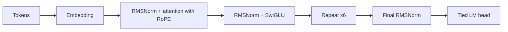
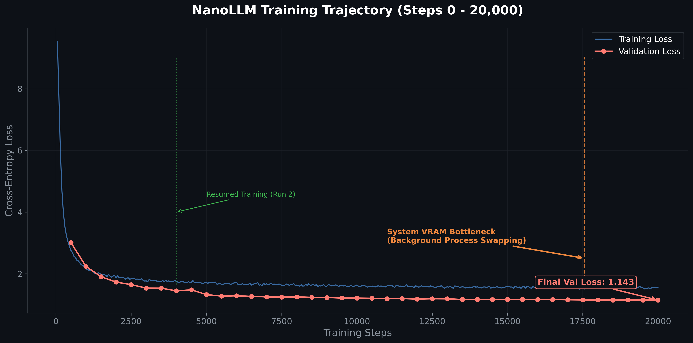
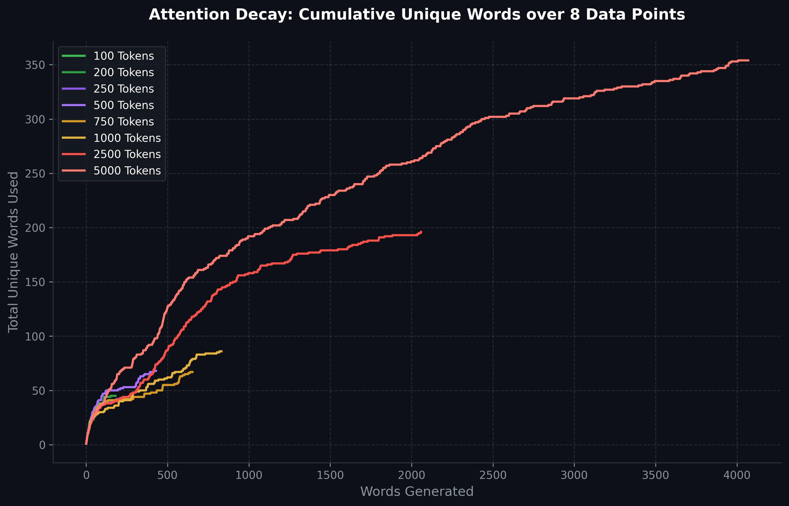

<div align="center">

# NanoLLM

A from-scratch, LLaMA-style language model small enough to train on a laptop GPU.

**29,920,512 parameters.** Six layers, hidden size 384, six heads, context 256.
Trained 20,000 steps on [TinyStories](https://huggingface.co/datasets/roneneldan/TinyStories) with one RTX 4060 Ti (8 GB).
Final validation loss **1.143** (perplexity **3.14**).

</div>

The weights at step 20,000 are in the repo. Generation is one command, and it runs on CPU.

## Highlights

- Decoder-only transformer with the same core pieces as LLaMA: **RMSNorm**, **RoPE**, **SwiGLU**, and a **tied** token embedding
- Training loop with bf16 autocast on CUDA, gradient accumulation (effective batch 256), cosine decay, and gradient clipping
- Published bfloat16 weights, the training log, and the loss curve from the 20,000-step run
- A short curriculum in `docs/`, from tensors through what the model does when the context gets long



## Parameter count

`NanoLLM.count_parameters()` on the config that matches the published checkpoint:

| Component | Parameters |
| --- | ---: |
| Token embedding, shared with the LM head (50,257 × 384) | 19,298,688 |
| Attention, 6 layers | 3,538,944 |
| SwiGLU, 6 layers (hidden size 1,024) | 7,077,888 |
| RMSNorm | 4,992 |
| **Total** | **29,920,512** |

The vocabulary is GPT-2 byte-pair encoding, 50,257 tokens. Weight tying is why the output layer is not counted a second time. `models/NanoLLM_20k_weights.pt` stores that matrix twice, and the two copies are identical.

## Tech stack

Python, PyTorch, Hugging Face `datasets` and `transformers` (GPT-2 tokenizer), TinyStories, Matplotlib.

## Setup

```bash
git clone https://github.com/NoticedXAaryan/NanoLLM.git
cd NanoLLM
python -m venv .venv
source .venv/bin/activate
pip install -r requirements.txt
```

Generate a story. CPU is enough:

```bash
python generate.py --prompt "Once upon a time" --max_new_tokens 80 --num_samples 1
```

One sample from the published weights (`temperature 0.8`, `top_k 40`):

> Once upon a time, there was a boy named Timmy. Timmy loved to play with his toy cars. He had a red car, a green car, and a big blue car. One day, Timmy's friend Billy came over to play. Billy wanted to play with Timmy's green car, but

Train from scratch. This downloads TinyStories, expects a CUDA GPU, and runs 20,000 steps:

```bash
python train.py
```

Run the smoke tests:

```bash
python -m unittest discover -s tests -v
```

Redraw the figures in `assets/`:

```bash
python scripts/generate_plots.py
python scripts/analyze_repetition.py
```

## Results



Validation loss at step 20,000 is **1.143** (perplexity **3.14**). Around step 17,550 the step time jumped from about 1.3 s to about 3.2 s because another process took VRAM and the GPU started paging. That episode is written up in [The Training Journey](docs/02_the_training_journey.md).

The model writes short children's stories. Past the 256-token window it starts repeating. [Model Behavior](docs/04_model_behavior.md) shows that decay with saved samples.



## Layout

| Path | Role |
| --- | --- |
| `model.py` | RMSNorm, RoPE, SwiGLU, the transformer, and sampling |
| `config.py` | Model and training hyperparameters |
| `train.py` | Training loop, evaluation, checkpoints |
| `generate.py` | Load the published weights and sample text |
| `data.py` | TinyStories download, tokenization, dataloaders |
| `models/NanoLLM_20k_weights.pt` | bfloat16 weights at step 20,000 |
| `docs/` | Curriculum |
| `tests/test_smoke.py` | CPU checks for shape, training step, and checkpoint load |

## Curriculum

1. [The Absolute Basics](docs/00_the_absolute_basics.md) covers tensors, loss, and backpropagation.
2. [Architecture Explained](docs/01_architecture_explained.md) covers RoPE, RMSNorm, SwiGLU, and weight tying.
3. [The Training Journey](docs/02_the_training_journey.md) covers the 8 GB GPU, gradient accumulation, and the VRAM stall.
4. [Build It Yourself](docs/03_build_it_yourself.md) walks the training loop.
5. [Model Behavior and Inference](docs/04_model_behavior.md) shows what happens as the generation gets longer.

## Status

Shipped: the model, the training loop, inference, the 20,000-step weights, the logs, and the docs.

The context window is 256 tokens. The training data is child-level stories, so the model stays inside that voice. There is no license file in the repo. Automated tests cover the architecture, one CPU optimizer step, checkpoint loading, and the data window. A full `python train.py` run is a multi-hour GPU job and is not part of those tests.

RoPE angles are computed during the forward pass. The copy of `rope_freqs` inside the published file is only the real part of that rotation, left behind by a bfloat16 cast, and it is not loaded.

Created by [Aaryan](https://www.linkedin.com/in/noticedxaaryan).
